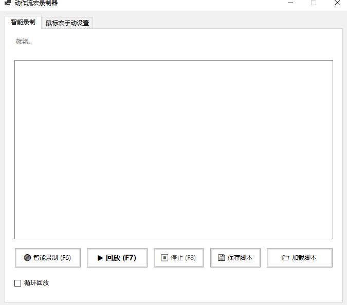
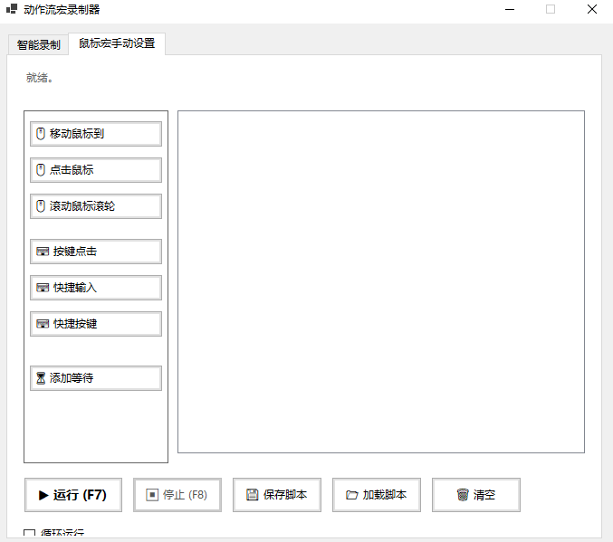

#  动作流宏录制器 (Mouse Macro Recorder)


一款基于 C# 和 WinForms 开发的 Windows 平台鼠标键盘自动化工具。与传统“逐帧记录坐标”的鼠标宏不同，本项目采用**“动作流（Action Flow）”**架构，将你的操作转化为结构化的指令列表。支持智能录制、手动脚本编辑、无限循环运行，生成的文件体积极小且运行极其稳定。

##  核心特性

- ** 智能动作流录制**：录制时自动过滤无效的鼠标移动帧，将操作转化为“移动、点击、等待”等结构化指令，并自动计算操作间隔。
- ** 可视化手动编辑**：提供直观的列表界面，支持随意添加、删除、上移、下移动作。
- ** 十字准星拾取**：告别反人类的倒计时拾取坐标，点击“拾取”后全屏变暗，十字准星实时显示坐标，左键确认，右键取消。
- ** 高精度输入模拟**：底层采用 Win32 `SendInput` API，完美兼容大多数 Windows 软件。
- ** 无限循环**：支持一键开启循环回放，配合全局紧急停止热键，防止宏失控。
- ** 脚本保存与加载**：将复杂的动作流保存为 `.json` 格式文件，方便随时修改、备份和分享。

##  软件界面

| 智能录制页面 | 手动设置页面 |
| :---: | :---: |
|  |  |
| *一键录制并生成动作流* | *精准配置各种操作参数* |

- **页面一：智能录制** - 一键录制、回放、保存。
- **页面二：鼠标宏手动设置** - 左侧动作库，右侧动作序列，支持右键插入、修改、删除。

##  快速开始

### 方式一：直接下载运行
1. 前往本仓库的 [Releases](../../releases) 页面。
2. 下载最新版本的 `MouseMacroRecorder.exe`。
3. ** 重要提示**：右键点击 exe 文件，选择 **“以管理员身份运行”**。因为软件需要调用系统级底层钩子和输入注入，非管理员权限可能导致无法控制部分软件。

### 方式二：从源码编译
确保你的电脑已安装 [.NET 8.0 SDK](https://dotnet.microsoft.com/download/dotnet/8.0)。

```bash
# 1. 克隆仓库
git clone https://github.com/your-username/MouseMacroRecorder.git

# 2. 进入项目目录
cd MouseMacroRecorder

# 3. 编译并发布为单文件 exe
dotnet publish -c Release -r win-x64 --self-contained true -p:PublishSingleFile=true
